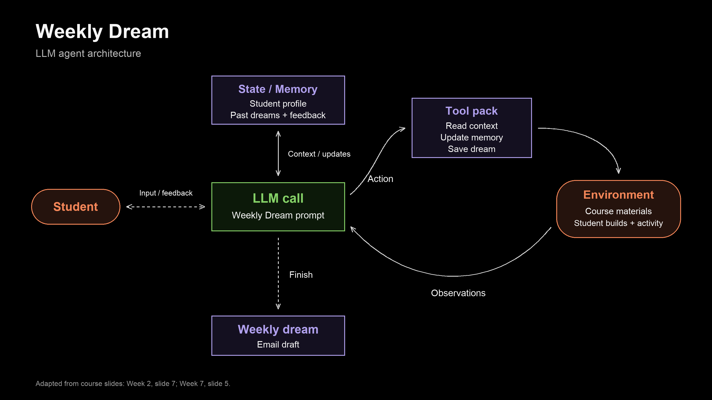

# Weekly dream architecture

Adapted from Week 2 slide 7 (agent-environment loop) and Week 7 slide 5 (state/memory).
The LLM follows the Weekly Dream prompt, uses tools to read course context and update
student memory, receives observations, and repeats until the dream draft is ready.
Email delivery remains to be connected.

Editable vector source: [SVG](assets/weekly-dream-architecture.svg).
Regenerate both assets with `examples/weekly-dream/render_architecture.py` using Python
with Pillow and the system Arial fonts. The diagram is conceptual: arrows to memory
represent context assembly and tool-mediated updates, not direct model filesystem access.
