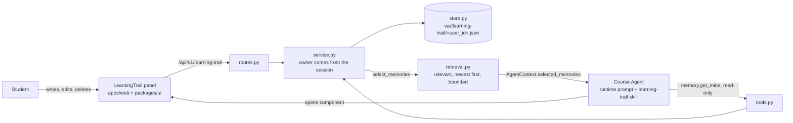

# Learning trail

A student saves one reflection per weekly build, attaches instructor or TA feedback to it, and marks
it as still relevant or not. The Course Agent reads those entries, so that help with a later
assignment can build on earlier weeks and say where it got that from.

Status: initial version. Scope and open questions are at the end. The tests and `make check` have
not been run on this code yet; do that first.

## How it fits together



Two paths reach the agent. On every run, `CourseAgentService` fills the existing
`AgentContext.selected_memories` slot, and the runtime prompt presents those as student-written data.
For anything more, such as a truncated entry or one the student set aside, the agent calls
`memory.get_mine`. The stable `Memory` contract is unchanged: an entry maps onto it with
`kind = "learning_trail.reflection"`.

## Who works where

The three parts can move independently. Each only depends on the seam named in its row.

| Part | Files | Seam to the others |
| --- | --- | --- |
| Data and memory logic | `models.py`, `store.py`, `service.py`, `retrieval.py` | `TrailStore` protocol; `select_trail_memories` |
| Student-facing UI | `packages/ui/src/LearningTrail.tsx`, `apps/web/src/LearningTrailPanel.tsx`, `apps/web/src/api.ts`, `routes.py` | The JSON shape of `TrailEntry` |
| Agent prompt and replies | `skills/learning-trail/SKILL.md`, `tools.py`, the memory section of `_agent_instructions` in `python/runtime_smolagents/runtime.py` | `Memory.metadata` fields; the `memory.get_mine` result |

Handy starting points:

- To change which entries the agent sees, edit `retrieval.py`. It is pure and needs no server.
- To change how the agent cites and connects them, edit the skill. No code change is needed.
- To move storage to SQLite or PostgreSQL, write another `TrailStore`. Nothing else should change.

## Data ownership

**Whose data.** The student's. Reflections are their own words, and the agent cannot write them.

**Where it comes from.** The student types reflections and pastes feedback from staff emails. Pasted
feedback is stored as `source: "pasted_by_student"` because the platform cannot verify that staff
wrote it, and both the panel and the agent describe it that way.

**Who can read it.**

- The student, through the panel.
- The Course Agent, during that student's own runs. Selected text goes to the configured model
  provider as part of the prompt.
- Course staff cannot see it in the application.
- Anyone with file access to the server can read the files. They are not encrypted at rest.

**Who can change it.** Only the student, through the panel. Every service method resolves the owner
from the trusted `PrincipalContext` and none accepts a user ID, so neither a client nor the model
can name another student. TA, instructor, admin, and anonymous principals have no trail.

**Deletion.** Deleting removes the entry from the file and from future prompts. An earlier agent
reply that quoted it stays in that conversation's history, like any other message.

## Decision ownership

- **Course Agent:** whether an entry bears on the current question, how to connect entries, when to
  open the panel.
- **Platform code:** identity, ownership, role filtering, validation, bounds, and which entries are
  selected. None of this depends on a prompt.
- **Student:** the words, and the relevance mark, which removes an entry from automatic context.
- **Bounds:** the constants in `models.py` and `retrieval.py` are safety and context limits, sized so
  a full course of roughly one entry per week fits.

## Running it

Follow the setup in [`class-agent/README.md`](../../../README.md), then:

```bash
uv sync
pnpm install
docker-compose up -d postgres
cp -n .env.example .env                  # add your own OPENAI_API_KEY; never commit .env
uv run python -m course_server.migrations apply
uv run python -m course_server.index_resources
uv run python -m course_server.admin create-user --help   # create a local student account
uv run python -m course_server.api       # terminal 1
pnpm dev                                 # terminal 2, http://localhost:5173
```

No migration is needed for this feature, and entries appear under `var/learning-trail/`. Log in as
the student and use the **Trail** shortcut in the header, or ask the agent to open your learning
trail. To see citations, save two or three reflections, then ask for help with a later assignment.

Run the feature's tests:

```bash
uv run pytest python/tests/test_learning_trail.py
pnpm --filter @class-agent/web exec vitest run src/LearningTrailPanel.test.tsx
```

Run `make check` before opening a pull request. The new component changes the registry, so its
contract tests must pass.

## Scope of this version

Included: reflections per build, pasted feedback, the relevance mark, automatic context and citation,
and the panel with a most-recent view and a timeline.

Not included yet:

- **Connection view.** The stretch goal. `TrailEntry` has no explicit links between entries yet; the
  agent connects them in conversation.
- **Staff-written feedback.** Attaching feedback directly from the mail workflow would give it
  verified provenance, but needs a decision about what staff may read.
- **Saving from chat.** The constitution also names `memory.save_mine`. It is left out so that the
  agent cannot write in a student's voice; a confirmation step like the email one could add it.
- **Course MCP.** External AI apps connected through the Course MCP do not see the trail.

Known limits:

- `FileTrailStore` serializes writes with an in-process lock, which suits the single API process
  in `deploy/`. Several API workers would need a different store.
- Up to 16,000 characters of entries are added to each run for students who have saved many, which
  adds model cost.
- The `students` skill audience also includes instructors, who see the skill but have no trail.

This feature does not change a stable contract. `memory.get_mine` comes from Phase 9 of the
constitution, ahead of the repository's current Phase 7. The Week 8 project asks for it directly, so
this is a deliberate deviation that a pull request should state.
