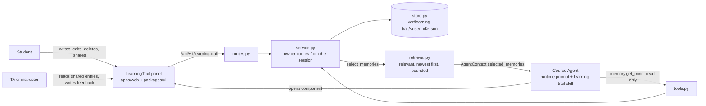

# Learning trail

A student saves one reflection per weekly build, and marks it as still relevant or not. Staff feedback
reaches an entry in two ways: a TA or instructor writes it on an entry the student shared, or the
student pastes it from an email. The Course Agent reads those entries, so that help with a later
assignment can build on earlier weeks and say where it got that from.

Status: initial version. `make check` passes. Scope and open questions are at the end.

## How it fits together



Two paths reach the agent. On every run, `CourseAgentService` fills the existing
`AgentContext.selected_memories` slot, and the runtime prompt presents those as student-written data.
For anything more, such as a truncated entry or one the student set aside, the agent calls
`memory.get_mine`. The stable `Memory` contract is unchanged: an entry maps onto it with
`kind = "learning_trail.reflection"`.

## Where to change what

| To change | Edit | Depends on |
| --- | --- | --- |
| Data and memory logic | `models.py`, `store.py`, `service.py`, `retrieval.py` | `TrailStore` protocol; `select_trail_memories` |
| The panels | `packages/ui/src/LearningTrail.tsx`, `apps/web/src/LearningTrailPanel.tsx`, `apps/web/src/api.ts`, `routes.py` | The JSON shape of `TrailEntry` |
| What the agent says | `skills/learning-trail/SKILL.md`, `tools.py`, the memory section of `_agent_instructions` in `python/runtime_smolagents/runtime.py` | `Memory.metadata` fields; the `memory.get_mine` result |

Handy starting points:

- To change which entries the agent sees, edit `retrieval.py`. It is pure and needs no server.
- To change how the agent cites and connects them, edit the skill. No code change is needed.
- To move storage to SQLite or PostgreSQL, write another `TrailStore`. Nothing else should change.

## Data ownership

**Whose data.** The student's. Reflections are their own words, and the agent cannot write them.
Feedback a TA or instructor wrote stays theirs in the sense that its author and role are recorded.

**Where it comes from.**

- The student types reflections.
- A TA or instructor writes feedback on an entry the student shared. It is stored as
  `source: "staff"`, with the author and role taken from their session, so it cannot be forged.
- The student can also paste feedback from an email. That is stored as
  `source: "pasted_by_student"` because the platform cannot verify who wrote it, and both the panel
  and the agent describe it that way.

**Who can read it.**

- The student, through the panel.
- TAs and instructors, for the entries that student shared. Sharing is a per-entry choice that is
  visible on the form and can be turned off later, which ends staff access to that entry at once.
  An entry left unshared never appears to staff, and staff cannot tell that it exists.
- The Course Agent, during that student's own runs. Selected text goes to the configured model
  provider as part of the prompt. No agent tool reads another student's trail, including for staff.
- Anyone with file access to the server can read the files. They are not encrypted at rest.

**Who can change it.**

- The student can change or delete their own entries, and delete feedback they pasted.
- A TA or instructor can add feedback to a shared entry, and remove staff-written feedback from it.
  They cannot edit a reflection or remove what the student pasted.
- A student cannot delete staff-written feedback on its own. They can stop sharing, or delete the
  whole entry, because the entry is theirs.

Every student method resolves the owner from the trusted `PrincipalContext`, so neither a client nor
the model can name another student. Staff methods take a student ID from the route, but check the
role from the session and return only shared entries. Admin and anonymous principals have no access.

**Deletion.** Deleting removes the entry from the file and from future prompts. An earlier agent
reply that quoted it stays in that conversation's history, like any other message.

## Decision ownership

- **Course Agent:** whether an entry bears on the current question, how to connect entries, when to
  open the panel.
- **Platform code:** identity, ownership, role filtering, validation, bounds, and which entries are
  selected. None of this depends on a prompt.
- **Student:** the words, the relevance mark, which removes an entry from automatic context, and
  whether staff can see each entry.
- **TA or instructor:** the feedback they write.
- **Bounds:** the constants in `models.py` and `retrieval.py` are safety and context limits, sized so
  a full course of roughly one entry per week fits.

## Running it

Follow the setup in [`class-agent/README.md`](../../../README.md), then:

```bash
uv sync
pnpm install
docker-compose up -d postgres
cp -n .env.example .env                  # add your own OPENAI_API_KEY; never commit .env
uv run python -m course_server.migrations apply
uv run python -m course_server.index_resources
uv run python -m course_server.admin create-user --help   # create a local student account
uv run python -m course_server.api       # terminal 1
pnpm dev                                 # terminal 2, http://localhost:5173
```

No migration is needed for this feature, and entries appear under `var/learning-trail/`. Log in as
the student and use the **Trail** shortcut in the header, or ask the agent to open your learning
trail. To see citations, save two or three reflections, then ask for help with a later assignment.

Run the feature's tests:

```bash
uv run pytest python/tests/test_learning_trail.py
pnpm --filter @class-agent/web exec vitest run src/LearningTrailPanel.test.tsx
```

Run `make check` before opening a pull request. The new component changes the registry, so its
contract tests must pass.

## Scope of this version

Included: reflections per build, feedback written by staff or pasted by the student, per-entry
sharing with staff, the relevance mark, automatic context and citation, and the panel with a
most-recent view and a timeline, plus a staff view of shared entries.

Not included yet:

- **Connection view.** The stretch goal. `TrailEntry` has no explicit links between entries yet; the
  agent connects them in conversation.
- **Saving from chat.** The constitution also names `memory.save_mine`. It is left out so that the
  agent cannot write in a student's voice; a confirmation step like the email one could add it.
- **Course MCP.** External AI apps connected through the Course MCP do not see the trail.

Known limits:

- `FileTrailStore` serializes writes with an in-process lock, which suits the single API process
  in `deploy/`. Several API workers would need a different store.
- Up to 16,000 characters of entries are added to each run for students who have saved many, which
  adds model cost.
- The `students` skill audience also includes instructors, who see the skill but have no trail of
  their own.

This feature does not change a stable contract. `memory.get_mine` comes from Phase 9 of the
constitution, ahead of the repository's current Phase 7. The Week 8 project asks for it directly, so
this is a deliberate deviation that a pull request should state.

## Technical notes for the writeup

A draft of the technical parts only. The reflection and evaluation prose are for the team to write.

**Encode.** A reflection is structured when it is saved: week, build title, optional HTTPS link, the
student's text, feedback with its source, the relevance mark, and whether it is shared.
`retrieval.py` turns each entry into a `Memory` of kind `learning_trail.reflection`.

**Store.** One validated JSON file per student, replaced atomically. See `store.py`.

**Retrieve.** On every run for a logged-in student, `CourseAgentService` calls `select_memories`,
which takes entries still marked relevant, newest week first, up to 16 entries and 16,000 characters.
The runtime prompt presents them as student-written data rather than instructions. The agent calls
`memory.get_mine` when it needs a truncated entry or one the student set aside.

**Observation space added by this feature.** The selected trail memories in `AgentContext`, the
`memory.get_mine` result, and the `learning-trail` component in the workspace.

**Tools and actions added by this feature.**

| Tool | Who | Effect |
| --- | --- | --- |
| `memory.get_mine` | Logged-in student's run | Reads their own trail. Read-only. |
| `workspace.open_component` with `learning-trail` | Agent, existing tool | Opens the panel. Carries at most an entry ID. |

Saving, sharing, and writing feedback happen only through the panel and its API, not through the
agent.

## Demo script

One interaction in which saved information changes a later reply:

1. Log in as a student and ask for help planning a later assignment. Note the generic reply.
2. Open **Trail** and save a reflection for an earlier week, such as what broke in a build and what
   you would do differently.
3. As a TA, open **Trail**, select the student, and write feedback on that entry.
4. Back as the student, start a new conversation and ask the same question. The reply should name the
   earlier build and the TA's feedback, and say where each came from.
5. Mark the entry as no longer relevant and ask again. The reply should stop relying on it.
